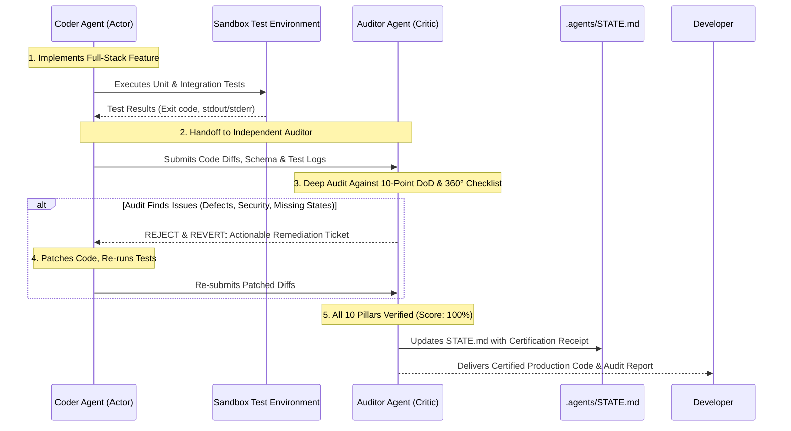

# CODER-AUDITOR SELF-HEALING REVIEW LOOP PLAYBOOK
## Autonomous Actor-Critic Code Review, Reversion & Remediation Engine

In top-tier engineering organizations, no code is merged without peer review. This playbook formalizes the **autonomous dual-agent review and self-correction loop** that runs automatically before any code is presented to the developer.

---

## 1. THE DUAL-AGENT ACTOR-CRITIC LIFECYCLE



---

## 2. THE AUDITOR AGENT INSPECTION RUBRIC

The Auditor Agent executes an independent inspection evaluating the 5 core failure domains:

### Pillar A: Security & Tenant Isolation (Zero Tolerance)
- [ ] Are all database queries parameterized? (Zero string interpolation in SQL).
- [ ] Is Object-Level Authorization (BOLA/IDOR) strictly derived from verified session tokens? Can User A access User B's records by changing IDs?
- [ ] Are passwords, API keys, and sensitive tokens stripped from logs and API serialization?

### Pillar B: Concurrency & State Integrity
- [ ] Are multi-table writes enclosed in explicit ACID transactions with rollback?
- [ ] Is there an `Idempotency-Key` mechanism protecting against concurrent double-submissions?
- [ ] Are race conditions mitigated via optimistic (`version` check) or pessimistic locking?

### Pillar C: Error Semantics & Boundary Defense
- [ ] Does ingress reject invalid data immediately via Zod/Pydantic schemas?
- [ ] Do all 4xx/5xx responses adhere to RFC 7807 Problem Details?
- [ ] Are all external HTTP/RPC calls constrained by explicit timeouts and cancellation propagation?

### Pillar D: Frontend UX & Accessibility Completeness
- [ ] Are all 4 UI states implemented? (Loading Skeleton, Empty State with CTA, Error State with Retry, Success State).
- [ ] Are image aspect ratios fixed to prevent layout shifts (CLS < 0.1)?
- [ ] Are interactive elements keyboard navigable with visible focus rings and ARIA labels?

### Pillar E: Test Integrity & Edge Verification
- [ ] Did tests run inside the sandbox and pass with exit code 0?
- [ ] Are boundary edge cases tested (null, empty string, negative values, maximum limits)?
- [ ] Are integration tests running against real infrastructure (Testcontainers) rather than mocks?

---

## 3. THE REVERSION & REMEDIATION TICKET SCHEMA

If the Auditor Agent finds ANY failure or code smell, it does not show incomplete work to the developer. It immediately halts delivery and dispatches this structured remediation ticket to the Coder Agent:

```json
{
  "audit_status": "REJECTED_NEEDS_REMEDIATION",
  "audit_score": "7/10",
  "critical_blockers": [
    {
      "issue_id": "AUDIT-01",
      "category": "CONCURRENCY_DOUBLE_WRITE",
      "file": "src/services/orderService.ts",
      "lines": "45-62",
      "defect": "Order creation and inventory decrement are executed in separate queries without an ACID transaction.",
      "required_fix": "Wrap both queries inside `db.transaction(async (tx) => { ... })`."
    },
    {
      "issue_id": "AUDIT-02",
      "category": "FRONTEND_MISSING_STATE",
      "file": "src/components/OrderList.tsx",
      "lines": "20-35",
      "defect": "Component returns null during loading instead of rendering the skeleton loader.",
      "required_fix": "Implement the `<OrderListSkeleton />` component with fixed aspect ratio."
    }
  ],
  "action_required": "Patch all critical blockers, re-run sandbox tests, and re-submit for audit."
}
```

---

## 4. CERTIFICATION & DELIVERY GATE

Only when all 10 pillars achieve a 100% pass score does the Auditor generate the **Production Certification Receipt**:

```markdown
### 🛡️ AUDITOR CERTIFICATION RECEIPT
- **Verdict**: ✅ CERTIFIED PRODUCTION-GRADE (10/10)
- **Remediation Cycles Run**: [0 | 1 | 2]
- **Verification Proof**:
  - Security (OWASP Top 10): PASSED (Parameterized queries, IDOR verified)
  - Concurrency & ACID: PASSED (Wrapped in transaction, idempotency key active)
  - Error Semantics: PASSED (RFC 7807 Problem Details format)
  - Frontend 4-State UI: PASSED (Skeleton, Empty, Error retry, Success)
  - Accessibility: PASSED (WCAG 2.1 AA compliant, zero CLS)
  - Automated Tests: PASSED (14/14 unit & integration tests passing in sandbox)
```
