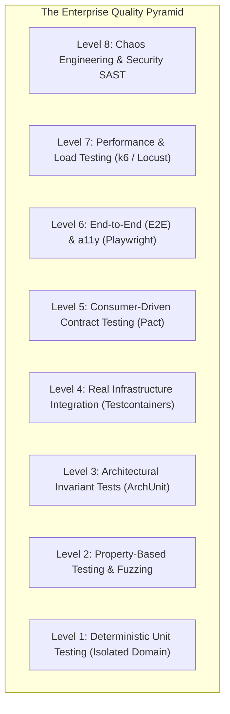
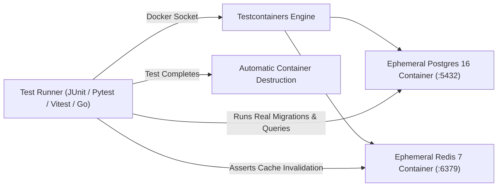

# THE ENTERPRISE TESTING PYRAMID & QUALITY PLAYBOOK
## Production Quality Engineering across Unit, Integration, Contract, E2E, Load & Security

---

## 1. THE COMPLETE 8-LEVEL TESTING HIERARCHY



---

## LEVEL 1 & 2: UNIT & PROPERTY-BASED TESTING
- **Deterministic Unit Testing**:
  - Test pure business logic, calculations, and state machines with zero network or database dependencies.
  - Structure tests using the **AAA Pattern** (Arrange, Act, Assert).
- **Property-Based Testing (Hypothesis, QuickCheck, Proptest)**:
  - Instead of testing single static examples (`assert add(2, 2) == 4`), define mathematical invariants:
    $$\forall a, b \in \mathbb{Z}: \text{add}(a, b) = \text{add}(b, a)$$
  - Let the runner generate thousands of pseudo-random permutations (Unicode strings, negative zero, max integers, nested nulls) to discover edge-case crashes.

---

## LEVEL 3: ARCHITECTURAL BOUNDARY TESTING
Prevent code rot where presentation components accidentally import database models:
- **Java**: ArchUnit asserts rules like `classes().that().resideInAPackage("..controller..").should().notDependOnClassesThat().resideInAPackage("..repository..")`.
- **TypeScript**: `dependency-cruiser` or `eslint-plugin-boundaries` asserting module dependency trees.

---

## LEVEL 4: INTEGRATION TESTING WITH TESTCONTAINERS
**Never mock your database or queue in integration tests.** Mocks hide SQL dialect differences, constraint violations, and transaction deadlocks.



- Supported in: Java/Kotlin, Python, Go, Node.js/TypeScript, Rust, C#/.NET.
- Runs on local developer machines and CI/CD pipelines without shared database state conflicts.

---

## LEVEL 5: CONSUMER-DRIVEN CONTRACT TESTING (PACT)
When Service A calls Service B in a microservices ecosystem:
- Traditional integration tests require deploying both services, which is slow and brittle.
- **Pact Workflow**:
  1. Consumer generates a contract file (`order-to-payment-contract.json`).
  2. Consumer tests pass against a local Pact mock server.
  3. Provider runs the contract against its real controllers in CI/CD.
  4. If Provider breaks a field, Provider's CI fails *before* deploying to staging.

---

## LEVEL 6: END-TO-END (E2E) & ACCESSIBILITY (PLAYWRIGHT)
- **Playwright Automation**:
  - Cross-browser execution (Chromium, Firefox, WebKit) and mobile viewport emulation.
  - Automatic waiting (zero flaky `sleep(5000)` calls).
  - StorageState caching: Authenticate once in a global setup, reuse session cookies across tests to avoid repetitive login flows.
- **Automated Accessibility Testing (`@axe-core/playwright`)**:
  - Injects axe-core on every page transition to assert zero WCAG 2.1 AA violations.

---

## LEVEL 7: PERFORMANCE & LOAD TESTING (k6)
Every critical API must have an automated load test script executed in staging:

```javascript
import http from 'k6/http';
import { check, sleep } from 'k6';

export const options = {
  stages: [
    { duration: '30s', target: 50 },  // Ramp-up to 50 users
    { duration: '1m', target: 200 },  // Stress at 200 users
    { duration: '30s', target: 0 },    // Ramp-down
  ],
  thresholds: {
    http_req_duration: ['p(95)<150', 'p(99)<300'], // 95% < 150ms
    http_req_failed: ['rate<0.01'],                 // Error rate < 1%
  },
};

export default function () {
  const res = http.get('https://api.example.com/v1/orders');
  check(res, { 'status is 200': (r) => r.status === 200 });
  sleep(1);
}
```

---

## LEVEL 8: SECURITY & SAST ANALYSIS
- **Static Application Security Testing (SAST)**: Semgrep and SonarQube integrated into CI/CD.
- **Dependency Auditing**: Automated alerts via Dependabot/Renovate, `npm audit`, `pip-audit`, `cargo audit`.
- **Container Vulnerability Scanning**: Trivy scanning base images for critical CVEs.
