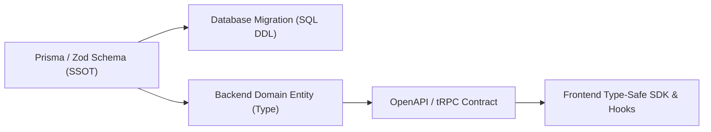

# CROSS-TIER FULL-STACK COHESION PLAYBOOK
## How Market-Standard Staff Engineers Interlink Every Tier

In real-world production environments, software tiers (Frontend, Backend, Database, Cloud, and Observability) do not exist in isolation. Elite developers operate with **End-to-End Cohesion**, ensuring contracts, state, types, and telemetry flow uninterrupted across boundaries.

---

## 1. THE SINGLE SOURCE OF TRUTH (SSOT) FOR TYPES
**Problem**: Maintaining separate TypeScript interfaces on frontend, Zod schemas on backend, and SQL DDL in database causes drift and runtime bugs.

**Market-Standard Solution**:
- **Schema-First Code Generation**:
  - Define data contracts once (e.g., Prisma Schema, Zod schema, or OpenAPI/Protobuf).
  - Automatically generate client-side TypeScript types and SDKs (e.g., Orval, OpenAPI-TS, Prisma Client).
  - *Golden Rule*: Any change to a backend domain entity automatically causes compile-time errors in the frontend until both sides align.

---

## 2. THE MUTATION LIFECYCLE (FRONTEND -> BACKEND -> DB -> CACHE -> EVENTS)
When a user triggers an action (e.g., clicking "Place Order"):

1. **Frontend Optimistic Update**:
   - UI updates immediately using TanStack Query / SWR optimistic cache.
   - Attaches a client-generated UUIDv4 `Idempotency-Key` and `x-correlation-id` to the request header.
2. **API Ingress & Boundary Validation**:
   - Middleware checks `Idempotency-Key` in Redis. If currently processing, returns `409 Conflict`; if already completed, returns cached result.
   - Ingress schema validator (Zod/Pydantic) rejects malformed payloads immediately with `RFC 7807 Problem Details`.
3. **Domain Service & Atomic Transaction**:
   - Opens a database transaction with appropriate isolation.
   - Modifies state using parameterized SQL/ORM queries.
   - Emits a transactional outbox record (`outbox_events` table) within the same ACID transaction to guarantee event publishing.
4. **Cache Invalidation & Event Dispatch**:
   - Cache-aside invalidation in Redis (`DEL user:orders:{userId}`).
   - Outbox worker pushes message to message broker (Kafka/RabbitMQ/Redis Streams) for background billing, emails, and analytics.
5. **Frontend Settlement**:
   - Server returns `201 Created` with new entity payload.
   - Frontend replaces optimistic state with server-confirmed state. If error occurs, rolls back with toast notification.

---

## 3. UNIFIED DISTRIBUTED OBSERVABILITY (END-TO-END TRACE PROPAGATION)
Never debug blind. Trace requests from click to database row:
- **Client**: Injects W3C `traceparent` header (`00-{trace_id}-{span_id}-01`).
- **API Gateway**: Passes `traceparent` to backend services.
- **Backend**: Attaches `trace_id` to all structured JSON log lines and OpenTelemetry spans.
- **Database**: Adds `trace_id` as a SQL query comment (`/* trace_id=... */` via SQLCommenter).
- **Outcome**: A single click allows searching logs across all systems to find the exact line and query that failed.

---

## 4. ZERO-DOWNTIME SCHEMA MIGRATIONS (EXPAND & CONTRACT)
Never run destructive DDL in a single release. Follow the 4-phase rollout:
1. **Expand**: Add new nullable column or table in database. Deploy backend code that writes to *both* old and new fields (dual-writing).
2. **Backfill**: Run background batch worker to populate new column for legacy rows.
3. **Switch Reads**: Update backend and frontend to read from new column.
4. **Contract**: Once traffic is 100% on new column, drop legacy column in a subsequent deployment.
