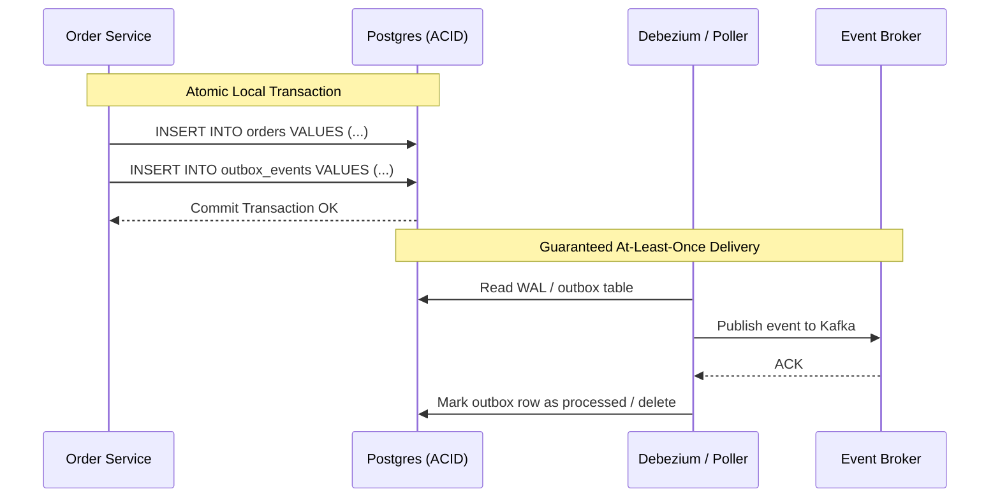

# ENTERPRISE MICROSERVICES ARCHITECTURE PLAYBOOK
## Production Patterns for Distributed Systems, Event-Driven Architectures & Resilient Services

---

## 1. DOMAIN DECOMPOSITION & BOUNDED CONTEXTS (DDD)
The foundation of scalable microservices is Domain-Driven Design:
- **Bounded Context**: Each microservice represents a distinct boundary with its own Ubiquitous Language.
- **Database-per-Service**: Under no circumstances should two microservices share a database. If Service A needs Service B's data, it queries Service B via API, or consumes asynchronous events emitted by Service B to maintain a read-optimized local projection.
- **Anti-Corruption Layer (ACL)**: When integrating with legacy systems or external APIs, build an adapter/ACL to translate foreign schemas into domain entities without polluting the internal domain model.

---

## 2. SYNCHRONOUS VS. ASYNCHRONOUS COMMUNICATION

### Synchronous (gRPC / HTTP/2):
- **When to Use**: Direct query/response where the client actively waits for immediate computation (e.g. User Auth, Real-Time Pricing).
- **Standards**:
  - High-performance Protocol Buffers (`.proto`) definitions with backward-compatible field numbering.
  - HTTP/2 multiplexing with connection pooling and client-side load balancing (Round Robin / Pick First).
  - Mutual TLS (mTLS) for zero-trust service-to-service encryption.

### Asynchronous (Event-Driven Architecture - EDA):
- **When to Use**: State changes, business events, notifications, workflows spanning multiple services (e.g. `OrderPlaced`, `PaymentCaptured`, `InventoryReserved`).
- **Standards**:
  - Use Apache Kafka, RabbitMQ, or NATS with partitioned topic keys (e.g. `partition_key = order_id`) to preserve strict in-order processing.
  - Event schemas governed by CloudEvents specification or Apache Avro/Protobuf with a Confluent/Aiven Schema Registry.

---

## 3. DISTRIBUTED DATA CONSISTENCY & THE SAGA PATTERN

### The Dual-Write Anti-Pattern & The Transactional Outbox
Writing to a database and publishing to a message broker in two separate operations is prone to partial failure:

```text
❌ Vulnerable Flow:
1. DB.insert(order) -> SUCCESS
2. Kafka.publish(OrderPlaced) -> NETWORK FAILURE (Message lost, data inconsistent!)
```



### The Saga Pattern (Distributed Workflow Coordination)
For distributed transactions spanning services (e.g. Order $\rightarrow$ Payment $\rightarrow$ Inventory $\rightarrow$ Shipping):

1. **Orchestrated Saga (Recommended)**:
   - A central **Saga Orchestrator** manages state transitions and executes compensating actions if any step fails.
   - Example Rollback: If Inventory Reservation fails, the orchestrator triggers `PaymentService.refundPayment()` and marks the order `CANCELLED`.
2. **Idempotent Consumers (Inbox Pattern)**:
   - Every consumer service must maintain an `inbox` table or check the `event_id` in Redis before executing business logic to guarantee exactly-once processing despite network retries.

---

## 4. RESILIENCE, FAULT TOLERANCE & RECOVERY
Distributed systems must be engineered under the assumption that the network will fail:

1. **Circuit Breakers**:
   - Wrap RPC calls in a Circuit Breaker (Closed $\rightarrow$ Open $\rightarrow$ Half-Open).
   - If error rate exceeds 50% over a 10-second rolling window, open circuit immediately to prevent cascading thread pool exhaustion.
2. **Deadline & Cancellation Propagation**:
   - Every RPC must pass a deadline (e.g. `timeout: 500ms`).
   - If the client times out or cancels, the cancellation signal must immediately propagate downstream through `context.Context` (Go) or AbortController (Node.js) to cancel active database queries and worker threads.
3. **Exponential Backoff with Full Jitter**:
   $$\text{sleep} = \text{random}(0, \min(M, B \times 2^{\text{attempt}}))$$
   *Never retry with a fixed delay*, as this creates a thundering herd that knocks downstream systems offline.
4. **Bulkheads**:
   - Isolate thread pools and HTTP connection pools per downstream service so a slow service cannot exhaust all available server threads.

---

## 5. OBSERVABILITY & SERVICE MESH
- **W3C Distributed Tracing**:
  Inject and propagate the `traceparent` header across all HTTP, gRPC, and Kafka boundaries.
- **Service Mesh (Istio / Envoy)**:
  - Offload mTLS, traffic management (Canary 90/10 rollouts), and circuit breaking to sidecar proxies.
  - Implement distributed token-bucket rate limiting at the API Gateway.
