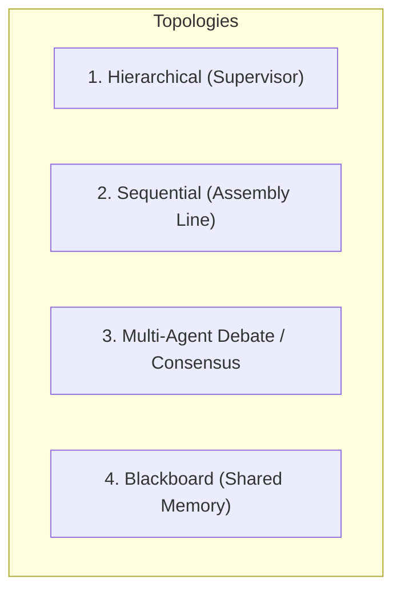

# MULTI-AGENT SYSTEMS (MAS) & AUTONOMOUS AGENTIC ARCHITECTURES
## Production Patterns for Agent Coordination, Memory, Tool Orchestration & Guardrails

---

## 1. MULTI-AGENT COORDINATION TOPOLOGIES
Multi-agent systems replace single monolithic prompts with specialized, collaborating agents operating under defined topologies:



### A. Hierarchical Supervisor Pattern (Leader-Follower)
- **The Supervisor Agent**: Ingests high-level user goals, breaks down tasks into a Directed Acyclic Graph (DAG), routes work to specialized worker agents, evaluates outputs against acceptance rubrics, and synthesizes the final response.
- **Worker Agents**: Highly specialized personas with restricted toolsets (e.g. `ResearchAgent`, `CodeAuthorAgent`, `TestRunnerAgent`, `SecurityAuditorAgent`).
- *Best For*: Complex feature development, end-to-end refactors, full-stack migrations.

### B. Sequential Assembly Line (Pipeline)
- Each agent performs a discrete step with schema-validated input/output gates:
  $$\text{PRD Agent} \longrightarrow \text{Architect Agent} \longrightarrow \text{Coder Agent} \longrightarrow \text{Test Agent} \longrightarrow \text{Reviewer Agent}$$
- If an agent at stage $N$ fails validation, it loops back to stage $N-1$ with error feedback.
- *Best For*: Deterministic code generation, CI/CD validation pipelines.

### C. Consensus & Multi-Agent Debate
- Multiple independent agents with divergent personas (e.g. `PerformanceOptimist`, `SecurityParanoid`, `MaintainabilityPragmatist`) evaluate a proposal.
- Agents debate through rounds of critique until achieving consensus or a tie-breaking vote by the Supervisor.
- *Best For*: Security reviews, financial transaction logic, critical infrastructure decisions.

### D. Blackboard / Shared Memory Pattern
- Agents do not talk directly to each other; they read from and post observations, hypotheses, and partial artifacts onto a centralized "Blackboard" (e.g. Shared Knowledge Graph or Redis State Store).
- Agents reactively trigger when new knowledge matching their specialization appears on the board.
- *Best For*: Complex investigative debugging, threat hunting, continuous system monitoring.

---

## 2. AGENT MEMORY & STATE HIERARCHY
Production agents maintain memory across four distinct tiers:

| Tier | Scope | Storage Mechanism | Retention Policy |
| :--- | :--- | :--- | :--- |
| **1. Scratchpad / In-Flight Context** | Immediate Turn | Model Context Window (Messages) | Cleared or compacted when conversation ends |
| **2. Working Memory** | Current Session / Task | Artifacts, `.agents/STATE.md`, scratch files | Persists across session turns; updated on milestones |
| **3. Episodic Memory** | Past Executions & Fixes | Vector Store (Chroma, pgvector) with metadata | Retrieved via semantic similarity on error traces |
| **4. Semantic Knowledge Graph** | Entity & Architecture Truth | MCP Memory Server (`@modelcontextprotocol/server-memory`) | Permanent persistent graph of entities, relations, and conventions |

---

## 3. AGENT-TO-AGENT (A2A) COMMUNICATION PROTOCOL
Agents communicate using standardized, type-safe message envelopes:

```json
{
  "message_id": "msg_01HXYZ999A",
  "correlation_id": "corr_task_888",
  "sender": "supervisor_agent",
  "recipient": "backend_coder_agent",
  "intent": "EXECUTE_SUBTASK",
  "payload": {
    "subtask_id": "ST-02",
    "objective": "Implement RFC 7807 problem details middleware in Express/TypeScript",
    "constraints": ["Strict TypeScript", "Must include unit tests", "Zero external dependencies beyond standard library"],
    "context_files": ["src/middleware/errorHandler.ts", "src/types/errors.ts"]
  },
  "timeout_seconds": 60,
  "state_hash": "sha256_abcdef..."
}
```

- **Handoff Contract**: All context needed to execute must be explicitly declared in `payload`. Never require the recipient agent to infer missing context from raw history.
- **Completion Response**: Worker replies with `{ status: "COMPLETED" | "FAILED" | "BLOCKED", artifacts: [...], validation_results: [...] }`.

---

## 4. AGENTIC GUARDRAILS, SAFETY & SELF-HEALING

### Loop Detection & Recursion Ceilings
- **Max Iteration Limits**: Hardcode `max_turns = 10` per subagent task. If ceiling is hit, escalate to supervisor or halt with diagnostic report.
- **Oscillation / Loop Detection**: Hash tool calls and outputs. If an agent executes identical tool calls 3 times with the same failing result, break loop and re-orient.

### Sandboxed Execution & Tool Isolation
- Tools executing shell commands or code must run inside isolated sandboxes (gVisor, Docker, or native Windows sandbox).
- Least-Privilege Tools: Do not grant destructive write/execute tools to agents that only need read access.

### Test-Driven Self-Correction (Reflexion Loops)
Never present unverified code to the user. Agents must execute this closed loop:
1. Generate implementation code.
2. Generate and run unit/integration tests in the sandbox.
3. If test fails, capture `stderr` and stack trace.
4. Pass failure trace back to the agent with instructions: *"The test failed with exit code 1 at line 42. Analyze the root cause and patch the implementation."*
5. Only return the solution once all verification checks pass.

### Human-in-the-Loop (HITL) Triggers
Agents must halt and request explicit user confirmation before:
- Dropping database tables or executing non-reversible schema migrations.
- Running commands with `BypassSandbox: true` that affect host networking or disk beyond the workspace.
- Making external API purchases, billing modifications, or dispatching external emails.
