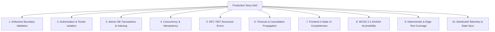

# PRODUCTION DEFINITION OF DONE (DoD) PLAYBOOK
## The 10-Point Non-Negotiable Standard for Production Software Engineering

When solving any User Story, enterprise engineers at top-tier companies verify these 10 dimensions before declaring work complete.

---

## THE 10 PRODUCTION PILLARS

---

### 1. DEFENSIVE BOUNDARY VALIDATION
- Validate all incoming data at the gateway/controller using runtime schemas (Zod, Pydantic, class-validator).
- Reject invalid, out-of-range, or unexpected fields immediately ($O(1)$ rejection before touching domain logic or database).
- Sanitize inputs to prevent XSS, SQL injection, and path traversal.

### 2. AUTHORIZATION & TENANT ISOLATION (BOLA/IDOR DEFENSE)
- Never rely on client-supplied user IDs from the body or query params. Always derive identity from the verified session/JWT claims.
- Enforce Object-Level Authorization: verify that `tenant_id` and `user_id` match the requested entity before reading or writing.

### 3. ATOMIC DATA TRANSACTIONS & INDEX HYGIENE
- Multi-row or multi-table mutations must be wrapped in an explicit ACID transaction with rollback on failure.
- Ensure new query filter columns are backed by composite B-Tree indexes.
- All primary keys must be time-ordered (UUIDv7/ULID) or 64-bit identity integers.

### 4. CONCURRENCY & IDEMPOTENCY
- All mutations (`POST`, `PUT`, `PATCH`) must support an `Idempotency-Key` header stored in Redis to prevent duplicate charges or double records from user double-clicks.
- Guard against race conditions using optimistic locking (`version` column) or pessimistic locking (`SELECT ... FOR UPDATE`).

### 5. RFC 7807 ERROR SEMANTICS
- Never return 200 OK with `{ error: "..." }` or blank 500 pages.
- Every error must return an RFC 7807 JSON payload: `{ type, title, status, detail, instance, invalid_params }`.

### 6. TIMEOUTS & CANCELLATION PROPAGATION
- Never make an unconstrained network call. Every external HTTP/RPC call must specify a timeout (e.g. 3000ms).
- Propagate cancellation signals (`ctx.Done()`, `AbortController`) to terminate long-running queries if the client disconnects.

### 7. FRONTEND 4-STATE UI COMPLETENESS
For every data-driven view component, you must implement all four states:
1. **Loading State**: Responsive skeleton loader (matching dimensions to prevent CLS).
2. **Success / Populated State**: Clean presentation of domain data with optimistic updates.
3. **Empty State**: Clear illustrated message and actionable primary CTA (e.g. "No orders yet. Create your first order").
4. **Error State**: Non-technical explanation with a "Retry" button.

### 8. ACCESSIBILITY (WCAG 2.1 AA/AAA) & CORE WEB VITALS
- Semantic HTML tags (`<main>`, `<nav>`, `<button>`).
- Full keyboard navigation with visible focus rings (`focus-visible:ring-2`).
- Screen-reader accessible labels (`aria-label`) on icon-only buttons.
- Zero layout shift (CLS < 0.1) with fixed aspect ratios on dynamic elements.

### 9. DETERMINISTIC & EDGE TEST COVERAGE
- Unit tests for domain logic covering boundaries (null, empty, negative, maximum integer, malformed strings).
- Integration test running real queries against an ephemeral database (via Testcontainers).
- Zero reliance on system clocks or unseeded random generators.

### 10. OBSERVABILITY & STATE CONTINUITY
- Log critical actions as structured JSON with `trace_id`, `user_id`, and `duration_ms`.
- Update `.agents/STATE.md` to mark the story as completed, recording newly introduced files and patterns.
