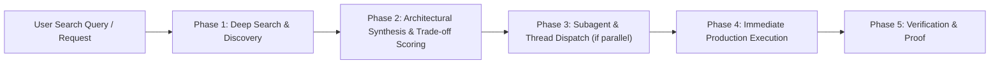

# Deep Search and Execute Engine

This skill equips Antigravity and its subagents to seamlessly transition from **searching and investigating** into **active, production-grade execution** without stalling or asking redundant questions.

---

## EXECUTION LOOP (SEARCH -> SYNTHESIZE -> EXECUTE)



---

## PHASE 1: TARGETED SEARCH & RECONNAISSANCE

When given a search topic or codebase investigation:

1. **Internal Codebase Search**:
   - Locate relevant symbols, functions, interfaces, and call sites.
   - Map existing architectural conventions, linters, and dependencies in `package.json`, `go.mod`, `Cargo.toml`, or `pyproject.toml`.
   - Never write code before understanding existing patterns.

2. **External Knowledge & Web/Doc Search**:
   - If using web tools (`search_web`, `fetch` MCP):
     * Query official documentation, changelogs, and GitHub issue trackers.
     * Prioritize stable LTS versions and deprecation notices over blog posts.
     * Search for known edge cases, CVE vulnerabilities, and memory leak reports.

---

## PHASE 2: SYNTHESIS & TRADE-OFF MATRIX

Do not dump raw search results. Present a crisp 3-column evaluation:

| Solution / Pattern | Key Advantages | Trade-offs & Risks | Recommendation |
| :--- | :--- | :--- | :--- |
| **Option A (Industry Standard)** | Battle-tested, zero extra deps | Slightly verbose setup | **Recommended** |
| **Option B (Third-party library)** | High developer ergonomics | Transitive dependencies, bundle size | Alternative |
| **Option C (Custom lightweight)** | Zero dependencies, tailored | Maintenance responsibility | Deferred |

---

## PHASE 3: SUBAGENT & THREAD ORCHESTRATION

If the task involves multiple distinct workstreams (e.g. researching an API while building frontend components):
- **Read-Only / Research Tasks**: Delegate heavy file searching or web fetching to the `research` subagent via `invoke_subagent` to keep the primary thread clean.
- **Independent Parallel Work**: Launch a `self` subagent with a clear, single-objective prompt.
- **Single Turn Focus**: If the task is straightforward, execute directly in the primary thread without unnecessary subagent overhead.

---

## PHASE 4: IMMEDIATE SURGICAL EXECUTION

Do not wait for permission if the direction is unambiguous. Transition directly into action:
1. Create or edit the necessary code files with complete, production-ready implementations.
2. Adhere to domain standards defined in `~/.gemini/GEMINI.md`.
3. Add defensive assertions, boundary validation, and error handling.

---

## PHASE 5: VERIFICATION & REGRESSION CHECK

1. Run syntax, type checks, and tests:
   ```bash
   npm run build # or npx tsc --noEmit
   npm test
   ```
2. Verify that existing interfaces remain unbroken.
3. Update [`.agents/STATE.md`](file:///c:/Users/bobharsh/Downloads/IDE%20config/.agents/STATE.md) to record the newly introduced pattern or dependency.
