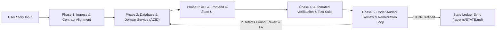

# Production User Story Implementation Engine

This skill guides Antigravity to act as a **Lead Staff Full-Stack Engineer**, taking a User Story from requirements to fully verified, battle-hardened production code through an **automated Coder-Auditor review and remediation loop**.

---

## MODULAR PLAYBOOKS (READ ON-DEMAND)
- [Coder-Auditor Review Loop](../../references/coder-auditor-review-loop.md): The autonomous actor-critic review and remediation protocol.
- [Production Definition of Done (DoD)](../../references/production-definition-of-done.md): The non-negotiable 10 production pillars.
- [Cross-Tier Full-Stack Cohesion](../../references/interlinked-fullstack-workflow.md): Type SSOT, mutation lifecycle, and trace propagation.
- [Domain Playbooks](../../references/): Frontend, Backend, Database, Microservices, Polyglot.

---

## 5-PHASE EXECUTION & AUDIT LIFECYCLE

---

### Phase 1: Ingress & Contract Alignment
1. Ingest user story, persona, and acceptance criteria.
2. Cross-reference `.agents/knowledge/domain-model.md` for business invariants.
3. Define the Single Source of Truth (SSOT) schema (Zod/Pydantic/Protobuf).

### Phase 2: Database & Domain Logic (ACID)
1. Write non-destructive database migrations with composite B-Tree indexes.
2. Enforce atomic ACID transactions for all multi-table mutations.
3. Add tenant isolation checks (prevent IDOR/BOLA).

### Phase 3: API & Frontend 4-State UI
1. Implement REST endpoint with RFC 7807 problem details and `Idempotency-Key` handling.
2. Build frontend component implementing all four required states:
   - Skeleton Loading State (matching dimensions to prevent CLS)
   - Populated / Success State (with optimistic updates)
   - Empty State (with actionable CTA)
   - Error State (with retry button)
3. Enforce WCAG 2.1 AA/AAA accessibility (semantic HTML, keyboard focus, ARIA labels).

### Phase 4: Automated Verification & Test Suite
1. Write deterministic unit tests for domain logic covering boundaries (null, empty, negative, max limits).
2. Write integration tests using real infrastructure (via Testcontainers).
3. Run tests in sandbox and resolve any failing assertions.

### Phase 5: Automated Coder-Auditor Review & Remediation Loop
Before delivering code to the developer, an independent audit pass is executed:
1. **Audit Inspection**: The Auditor Agent evaluates the implementation against the 10-Point DoD and 360° Checklist.
2. **Reversion & Remediation**: If ANY defect, missing UI state, security omission, or N+1 query is spotted:
   - Generate a remediation ticket.
   - Revert back to the Coder Agent to patch the code and re-test.
3. **Certification & Delivery**: Once all 10 pillars achieve 100%, generate the **Auditor Certification Receipt** and update `.agents/STATE.md`.
