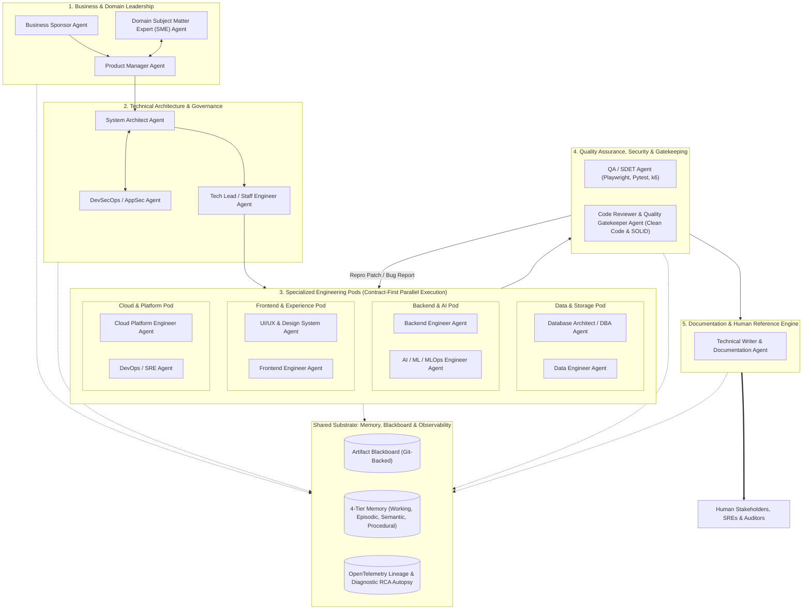

# Multi-Agent Software Engineering System (MAS)

An enterprise-grade, deterministic multi-agent system that mirrors an elite software engineering organization. Spans the entire lifecycle from business ideation to verified production releases with contract-first parallel pods, multi-tier memory, cognitive deliberation, cross-pod consensus, and human-in-the-loop governance.

---

## 📚 Core Architecture & Documentation

Before developing or extending the system, review the master design handbook:
- 📖 **[Master Architecture & Design Rationale Handbook](file:///c:/Users/bobharsh/MAS/docs/ARCHITECTURE_AND_DESIGN_RATIONALE.md)**: Deep dive into the cognitive deliberation engine, multi-tier memory architecture, cross-pod RFC protocol, diagnostic assignment router, and quality gates.

---

## 🏛️ System Overview



---

## 🔑 Key Engineering Principles

1. **No Unstructured Chat Swarms**: Agents coordinate exclusively via typed, canonical artifacts (`PRD.md`, `ADR-*.md`, `api-spec.yaml`, `code.patch`, `test_report.json`) committed to a Git-backed Blackboard.
2. **Contract-First Parallel Pods**: Frontend, Backend, AI, Data, and Cloud pods build against mock schemas and contracts in parallel, merging at the integration gate.
3. **Cognitive Deliberation ("Intelligent, Not Dumb")**: Agents operate with extended reasoning token budgets (`thoughts_token_count`), mandatory pre-mortem failure analysis, and formal trade-off matrices.
4. **Cross-Pod Deliberation (RFC Protocol)**: When trade-offs or bottlenecks arise, agents issue formal consultation requests (`RFCRequest`) and record consensus (`ConsensusDecisionRecord`) before coding.
5. **Intelligent Loopback & Assignment Router**: When a test or build fails, the diagnostic triage engine determines root-cause attribution and routes a scoped remediation ticket to the exact responsible role.
6. **Zero-Waste Scope Governance**: Just-In-Time (JIT) pod activation awakens only the relevant agents for a task. Strict token ceilings and a 3-strike circuit breaker eliminate runaway loops.
7. **Human Reference & Audit Bridge**: The `TechnicalWriterAgent` translates all technical activity into 6 human-readable suites (`EXECUTIVE_SUMMARY.md`, `ARCHITECTURE.md`, `API_REFERENCE.md`, `RUNBOOK.md`, `README.md`, `AUDIT_REPORT.md`).

---

## 🗂️ Codebase Architecture

```
c:\Users\bobharsh\MAS\
├── config/                        # Global system settings & domain ontologies
│   ├── system_settings.yaml       # Token caps, turn limits, model selections
│   └── domain_rules.yaml          # Domain axioms for SME verification
├── docs/                          # Architectural documentation
│   └── ARCHITECTURE_AND_DESIGN_RATIONALE.md
├── mas/
│   ├── core/                      # Engine Foundations & State Graph
│   │   ├── config.py              # Pydantic system settings & budget limits
│   │   ├── state.py               # Immutable State schemas (Task, State, Artifact)
│   │   ├── blackboard.py          # Git-backed artifact storage & ledger
│   │   ├── circuit_breaker.py     # Hard budgets & anti-infinite-loop traps
│   │   ├── rfc.py                 # Cross-pod peer consultation & consensus protocol
│   │   ├── router.py              # Intelligent loopback & blame-free attribution router
│   │   ├── cognition.py           # Pre-mortem analysis & extended thinking engine
│   │   └── orchestrator.py        # Directed state machine & dynamic pod dispatch
│   ├── memory/                    # Multi-Tier Memory Engine
│   │   ├── working.py             # In-context scratchpad with compaction
│   │   ├── episodic.py            # SQLite/Postgres event-sourced audit ledger
│   │   ├── semantic.py            # Vector DB (Chroma/Qdrant) + Domain GraphRAG
│   │   └── procedural.py          # Skill & tool schema registry
│   ├── agents/                    # Specialized Agent Definitions (Decoupled)
│   │   ├── base.py                # BaseAgent with schema-validated input/output
│   │   ├── leadership/            # Sponsor, PM, SME, Architect, TechLead
│   │   ├── engineering/           # Frontend, Backend, DBA, Data, AI, Cloud, SRE
│   │   └── governance_docs/       # Security, Code Reviewer, QA/SDET, Technical Writer
│   ├── tools/                     # Deterministic Procedural Tools & Sandboxes
│   │   ├── file_ops.py            # Safe git and file reading/writing
│   │   ├── sandbox.py             # Ephemeral subprocess runner (Docker / subproc)
│   │   ├── linter.py              # Ruff, Mypy, ESLint, Prettier runners
│   │   └── domain_verifier.py     # Domain ontology rule checker
│   ├── observability/             # Full Lineage, Telemetry & Root Cause Analysis
│   │   ├── tracer.py              # OpenTelemetry distributed trace & cost tracker
│   │   └── autopsy.py             # Diagnostic triage agent (Automated RCA)
│   └── hitl/                      # Human-in-the-Loop Governance
│       ├── gates.py               # Interactive approval triggers (CLI / Webhook)
│       └── policies.py            # Escalation condition checkers
├── tests/                         # Unit & Integration test suite
├── main.py                        # Primary CLI Entrypoint
├── requirements.txt
└── pyproject.toml
```

---

## 🚀 Phased Implementation Roadmap

- **Phase 1**: Core Substrate, State & Memory (`mas/core/`, `mas/memory/`).
- **Phase 2**: Domain Invariant Verifier & Sandboxed Deterministic Tools (`mas/tools/`).
- **Phase 3**: Specialized Agent Pods & Orchestration Graph (`mas/agents/`, `mas/core/rfc.py`, `mas/core/router.py`).
- **Phase 4**: OpenTelemetry Lineage, Diagnostic Autopsy (RCA), HITL Gates & Main CLI.
