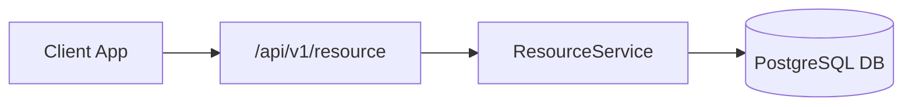

# System Architecture & Technical Rationale: Real-Time Payment Gateway

## C4 System Flow

## Architectural Decisions
- Grounded in ADR-001 (Contract-First Interface Design).
- Concurrency and lock protection enforced via non-locking DDL migrations.
