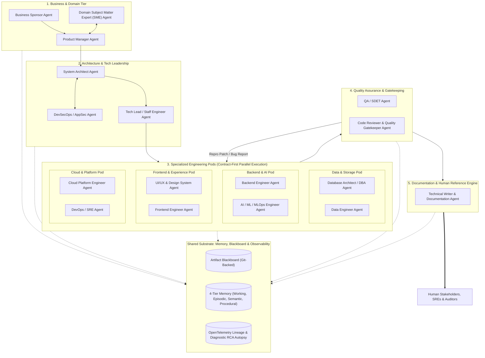
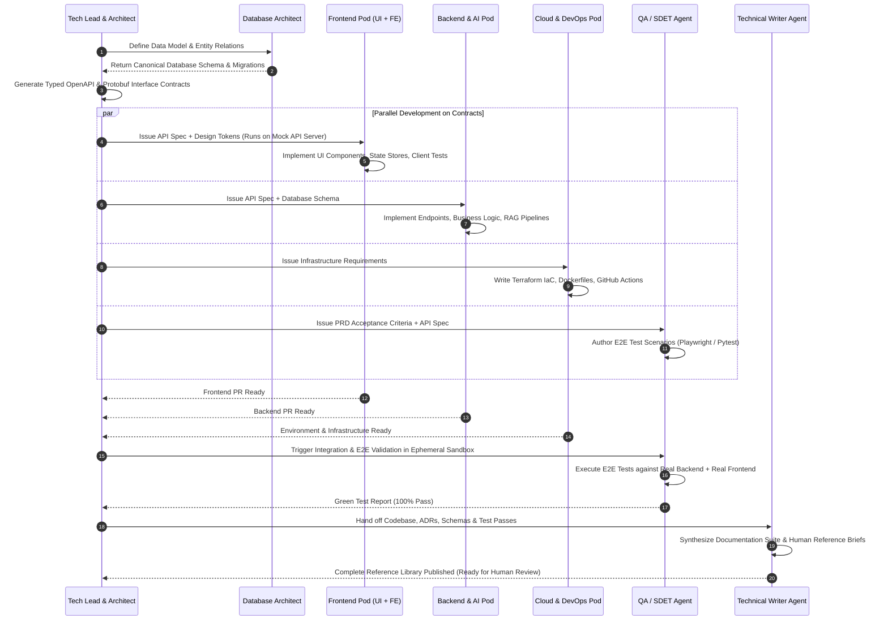
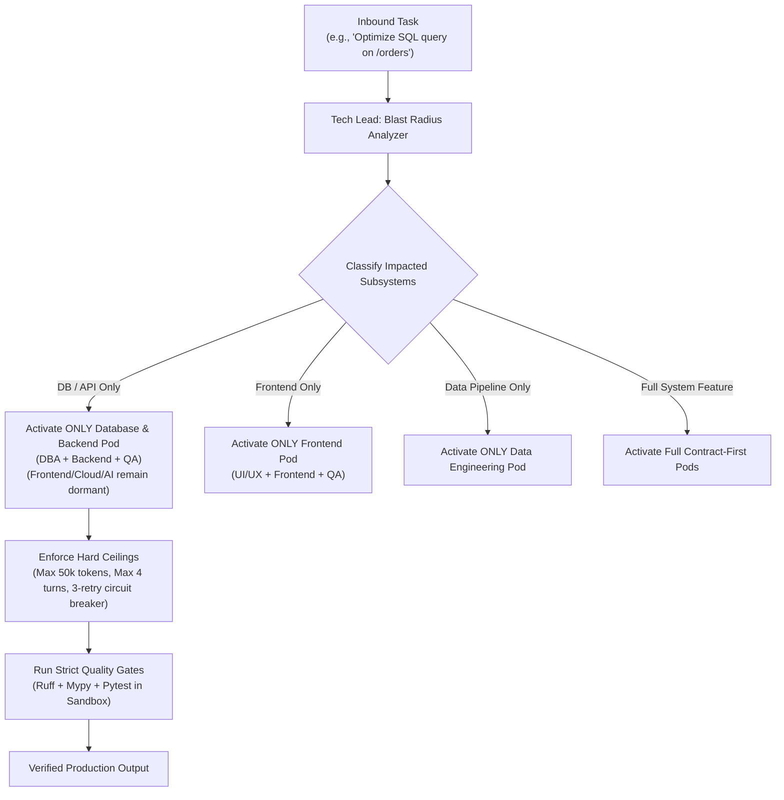
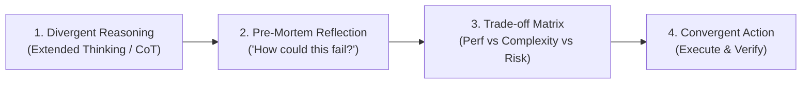
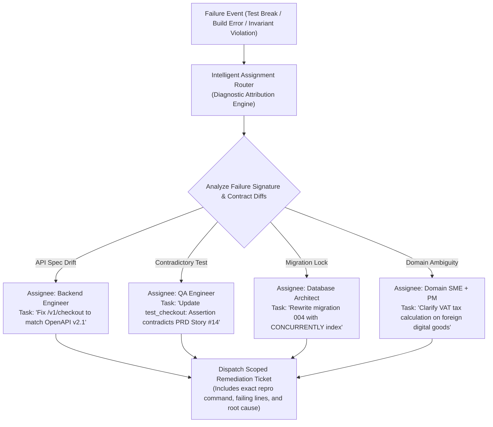
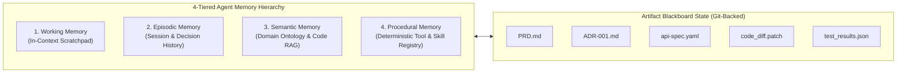

# Master Architecture & Design Rationale Handbook
## Enterprise Multi-Agent Software Engineering System (MAS)

> **Document Status**: Authoritative Reference Specification  
> **Last Updated**: 2026-10-28  
> **Scope**: Foundational theory, cognitive deliberation design, multi-tier memory, cross-pod communication, intelligent loopback, and implementation plan.

---

## Table of Contents
1. [Foundational Paradigm & The "Why"](#1-foundational-paradigm--the-why)
2. [Complete Engineering Roster & Specialized Pods](#2-complete-engineering-roster--specialized-pods)
   - [2.1 The Contract-First Parallel Pod Execution Model](#21-the-contract-first-parallel-pod-execution-model)
   - [2.2 Just-In-Time (JIT) Dynamic Scope & Resource Bounding](#22-just-in-time-jit-dynamic-scope--resource-bounding)
3. [Cognitive Deliberation Engine ("Intelligent, Not Dumb")](#3-cognitive-deliberation-engine-intelligent-not-dumb)
4. [Cross-Pod Deliberation Protocol (The RFC Mechanism)](#4-cross-pod-deliberation-protocol-the-rfc-mechanism)
5. [Intelligent Loopback & Dynamic Assignment Router](#5-intelligent-loopback--dynamic-assignment-router)
6. [Multi-Tier Memory & The Artifact Blackboard](#6-multi-tier-memory--the-artifact-blackboard)
7. [Domain Grounding & SME Verification Engine](#7-domain-grounding--sme-verification-engine)
8. [The Documentation Agent: Human Reference & Audit Bridge](#8-the-documentation-agent-human-reference--audit-bridge)
9. [Human-in-the-Loop (HITL) Gating Matrix](#9-human-in-the-loop-hitl-gating-matrix)
10. [Observability, Lineage & Root Cause Analysis (RCA)](#10-observability-lineage--root-cause-analysis-rca)
11. [Phased Modular Implementation Roadmap](#11-phased-modular-implementation-roadmap)

---

## 1. Foundational Paradigm & The "Why"

### 1.1 The Failure Mode of Naive Multi-Agent Swarms
Most multi-agent systems fail in real-world software engineering because they treat agents like people chatting in an unconstrained Slack channel. This creates:
1. **Context Drift & Memory Poisoning**: As conversation threads grow, context windows fill up with redundant pleasantries and obsolete hallucinations.
2. **Infinite Ping-Pong Deadlocks**: Developer and QA agents argue back and forth over a failing test without an architectural arbiter or termination guarantee.
3. **Runaway Resource Waste**: Agents spin up dozens of LLM calls to solve tasks with no regard for token cost, scope boundaries, or blast radiuses.
4. **Shallow / "Dumb" Thinking**: LLMs given simple direct prompts jump to the first knee-jerk code snippet without analyzing edge cases, race conditions, or backward compatibility.

### 1.2 The Real-World Engineering Blueprint
In elite software companies, teams coordinate through:
- **Typed, Versioned Artifacts**: PRDs, ADRs, OpenAPI specs, schema migrations, pull request diffs, and test reports.
- **Contract-First Development**: Clear interface boundaries allowing frontend, backend, data, and cloud engineers to work in parallel.
- **Deterministic Quality Gates**: Linters (`ruff`, `eslint`), static type checkers (`mypy`), AST parsers, and unit test suites running in sandboxes, rather than relying on LLM intuition.
- **Hierarchical Governance**: Clear ownership, escalation paths, and strategic human checkpoints.



---

## 2. Complete Engineering Roster & Specialized Pods

Engineering is divided into **disciplined pods** with strictly bounded blast radiuses. Agents are instantiated **Just-In-Time (JIT)** based on the task's blast radius.

### Roster Matrix

| Pod | Role | Primary Focus | Procedural Tools & Skills | Canonical Deliverables |
| :--- | :--- | :--- | :--- | :--- |
| **Business** | **Business Sponsor** | ROI, business goals, budget, timelines | Financial & timeline evaluators | `ProjectCharter.json` |
| **Product** | **Product Manager** | User stories, acceptance criteria (Given/When/Then) | PRD authoring, user journey maps | `PRD.md`, Epics, Stories |
| **Domain** | **Domain SME** | Regulatory rules (HIPAA, PCI-DSS), tax, domain ontology | Domain validator, ontology checker | `DomainValidationMatrix.json` |
| **Architecture**| **System Architect** | Macro architecture, NFRs, microservices, ADRs | C4 models, ADR templates | `ADR-*.md`, System Architecture |
| **Leadership** | **Tech Lead / Staff**| Workstream DAG, API contracts, pod coordination | OpenAPI generators, DAG schedulers | `TaskDAG.json`, `api-spec.yaml` |
| **Data Pod** | **Database Architect** | Relational schemas, NoSQL, Vector DBs, migrations | SQL formatters, schema diffing | `schema.sql`, `migrations/` |
| **Data Pod** | **Data Engineer** | Ingestion pipelines, ETL/ELT (dbt, Spark, Kafka) | dbt CLI, SQLGlot, pipeline runners | dbt models, data pipelines |
| **Backend/AI** | **Backend Engineer** | REST/GraphQL APIs, business logic, ACID safety | Ruff, Mypy, Pytest/Go test | Service code, Unit tests |
| **Backend/AI** | **AI / ML Engineer** | RAG retrieval, vector search, prompt chains, evals | LiteLLM, LangChain, Eval harnesses | RAG pipelines, Model configs |
| **Frontend** | **UI/UX Designer** | Design tokens, layouts, accessibility (WCAG) | Token validators, a11y linters | `DesignTokens.json`, Wireframes |
| **Frontend** | **Frontend Engineer**| Web/mobile apps (React, Next.js), Web Vitals | Prettier, ESLint, TypeScript, Jest | UI components, Client tests |
| **Cloud/Platform**| **Cloud Engineer** | IaC (Terraform/OpenTofu), VPCs, IAM policies | Terraform CLI, cloud SDKs, TFLint | `main.tf`, Cloud manifests |
| **Cloud/Platform**| **DevOps / SRE** | Docker, Kubernetes, CI/CD, SLIs/SLOs | Hadolint, Actionlint, Helm | `Dockerfile`, CI/CD pipelines |
| **Security** | **DevSecOps / AppSec**| Threat modeling (STRIDE), SAST/DAST, secrets | Trivy, Semgrep, TruffleHog | `SecurityAuditReport.json` |
| **Quality** | **QA / SDET** | E2E (Playwright), integration, load tests (k6) | Playwright, Pytest, k6 | `TestPlan.md`, `TestReport.json` |
| **Quality** | **Code Reviewer** | Clean code, SOLID, anti-patterns, style guides | Static code analyzers, Diff checkers | `ReviewDecision.json` |
| **Documentation**| **Technical Writer**| Human-friendly docs, API guides, runbooks | TypeDoc, Sphinx, Markdown/Mermaid | `README.md`, `RUNBOOK.md`, docs |

---

### 2.1 The Contract-First Parallel Pod Execution Model

In traditional broken multi-agent setups, agents execute linearly: the frontend agent waits for the backend agent, who waits for the DBA, who waits for the cloud engineer. This causes severe bottlenecks and timeouts.

In our real-world architecture, we execute a **Contract-First Parallel Model**:



---

### 2.2 Just-In-Time (JIT) Dynamic Scope & Resource Bounding

To ensure the system **does not work infinitely or hallucinate beyond its mandate**, every task goes through an explicit **Blast Radius & Scope Analyzer**:



1. **Selective Agent Awakening**: Non-relevant agents are **never spawned**. If the task is a backend API fix, the UI/UX, Cloud, and Data Engineer agents are never initialized, saving thousands of tokens.
2. **Hard Turn & Token Ceilings**: Each agent execution is wrapped in a hard token budget (e.g. 50,000 tokens) and turn limit (e.g. 5 steps).
3. **Loop Circuit Breaker**: If tests fail 3 consecutive times, execution halts immediately and trips an emergency escalation to prevent infinite loops.

---

## 3. Cognitive Deliberation Engine ("Intelligent, Not Dumb")

To make LLM agents think like **Principal Engineers and Staff Architects** rather than shallow prompt completers:



1. **Extended Thinking Budget (`thoughts_token_count`)**:
   - High-stakes agents (Architect, Tech Lead, Backend, DBA) run with explicit **Reasoning Budgets** (e.g. Gemini 2.5/3.0 Pro Thinking). They formulate, critique, and discard hypotheses in their internal reasoning space before taking action.

2. **Mandatory Pre-Mortem Analysis**:
   - Before any code commit, schema alteration, or architectural decision is finalized, the agent executes an internal **Pre-Mortem**:
     > *"Assume it is 6 months from now and this change caused a Sev-1 production outage or severe data corruption. What broke? Did I introduce a race condition? Did I handle null pointer exceptions, network timeouts, timezone discrepancies, connection pool exhaustion, or backward compatibility?"*

3. **Explicit Trade-off Evaluation (Two-Way vs One-Way Doors)**:
   - For every architectural and data modeling choice, agents must evaluate:
     - **Option A vs Option B**: Latency vs Memory vs Implementation Complexity.
     - **Reversibility**: Is this decision a two-way door (easy to revert) or a one-way door (hard to migrate)? If one-way, trigger peer consultation or human sign-off.

4. **Self-Correction & Reflection Loop**:
   - After running a tool or test, the agent compares the *actual output* against the *expected outcome* using cognitive diffing before declaring the step complete.

---

## 4. Cross-Pod Deliberation Protocol (The RFC Mechanism)

In real software organizations, engineers do not work in isolated silos; when unexpected trade-offs, performance bottlenecks, or contract mismatches arise, they **cross-communicate and deliberate** to reach consensus.

Our architecture implements a structured **Request for Consultation (RFC) Protocol** to enable intelligent, multi-agent negotiation without chaotic chatter:

```mermaid
sequenceDiagram
    autonumber
    participant FE as Frontend Engineer
    participant BE as Backend Engineer
    participant DBA as Database Architect
    participant BB as Artifact Blackboard

    FE->>BE: Issue RFCRequest("GET /products payload is 14MB; mobile browser freezes")
    Note over FE,BE: Includes: Problem Statement, 2 Proposed Alternatives, Trade-offs
    
    BE->>DBA: Consult: "Can we support cursor-based pagination and projection index?"
    DBA-->>BE: Consultation Response: "Yes, keyset pagination on (category_id, created_at)"
    
    BE-->>FE: Counter-Proposal: "Cursor pagination + field masking (?fields=id,name,price)"
    FE->>FE: Evaluate Client Rendering Impact (Cognitive Reflection)
    FE-->>BE: Consensus Reached: "Approved. Pagination + sparse fields accepted."
    
    BE->>BB: Commit ConsensusDecisionRecord (CDR-042)
    BB-->>BB: Automatically updates `api-spec.yaml`
```

- **RFC Triggers**:
  - *Contract Mismatch*: Frontend discovers API payload doesn't fit UI state needs.
  - *Data & Scale Bottleneck*: Backend discovers relational transaction causes locks; consults DBA for Redis cache or document partition.
  - *Security & Privacy Conflict*: Backend plans to log a field; AppSec flags GDPR/PII compliance violation.
- **Output Artifact**: A **Consensus Decision Record (CDR)** committed to the Blackboard, updating shared contracts *before* anyone writes conflicting code.

---

## 5. Intelligent Loopback & Dynamic Assignment Router

When something fails (e.g., integration test breaks, build fails, or domain invariant is violated), dumb multi-agent systems blindly bounce the error back to the last coder.

Our system features an **Intelligent Assignment Router** that performs **Root Cause Attribution** to decide **who to assign and what specific task to assign**:



1. **Failure Diagnosis**: The router extracts stdout, stderr, AST line numbers, and git diff provenance.
2. **Responsibility Attribution**: Compares the failure against the contractual baseline (PRD vs ADR vs OpenAPI vs Test Assertion) to determine the true culprit.
3. **Targeted Task Dispatch**: Generates an atomic, highly contextual remediation ticket with an exact reproduction script (`pytest tests/integration/test_cart.py -k test_tax_calc`), preventing the assigned agent from having to guess what broke.

---

## 6. Multi-Tier Memory & The Artifact Blackboard

Agents never communicate through raw, unbounded group chat transcripts. Instead, memory is stratified into **4 formal tiers**:



1. **Tier 1: Working Memory (In-Context Scratchpad)**:
   - Holds active task slice, immediate tool execution returns, and immediate sub-goals.
   - Automatically compacted using sliding-window summarization when approaching token limits.
2. **Tier 2: Episodic Memory (Event Sourcing & SQLite Audit Log)**:
   - Immutable transaction ledger of all agent turns, state transitions, reviews, and decisions.
3. **Tier 3: Semantic Memory (Domain GraphRAG & Vector Codebase)**:
   - Knowledge graphs for domain ontologies + vector embeddings of organizational coding guidelines, design systems, and historical post-mortems.
4. **Tier 4: Procedural Memory (Deterministic Tool Registry)**:
   - Rigidly typed tool definitions, AST linters, compiler invocations, test runners, and git wrappers.

---

## 7. Domain Grounding & SME Verification Engine

Subtle bugs and hallucinations occur when agents assume domain definitions.
- **Ubiquitous Language (DDD)**: Core terms (e.g., `Settlement`, `AccountBalance`, `InvoiceStatus`) have mathematically strict schemas.
- **Pre-Action Grounding**: The `DomainSMEAgent` checks all requirements against `config/domain_rules.yaml` before any design or code begins.
- **Deterministic Verification**: Code logic is validated against property-based invariant checks (`hypothesis` / domain assertion rules) rather than LLM guesswork.

---

## 8. The Documentation Agent: Human Reference & Audit Bridge

To eliminate the "Black Box Dilemma", the **Technical Writer & Documentation Agent** synthesizes technical state into **6 human reference deliverables**:

1. **Executive Decision Brief (`EXECUTIVE_SUMMARY.md`)**: 1-page overview of business value, token cost, and accepted trade-offs for human sponsors.
2. **System Architecture Guide (`ARCHITECTURE.md` & `C4_DIAGRAMS.md`)**: Visual Mermaid diagrams grounded in ADR rationale.
3. **Interactive API & SDK Reference (`API_REFERENCE.md`)**: OpenAPI-generated reference with runnable `curl` snippets.
4. **Operations Runbook (`RUNBOOK.md`)**: Deployment instructions, zero-downtime migration steps, and incident recovery playbooks for SREs.
5. **Developer Setup Guide (`README.md` & `CONTRIBUTING.md`)**: Step-by-step local prerequisites, docker start, and test commands.
6. **Audit & Compliance Dossier (`AUDIT_REPORT.md`)**: End-to-end provenance linking business requirements, SME approvals, commit hashes, and QA certificates.

---

## 9. Human-in-the-Loop (HITL) Gating Matrix

Humans act as **strategic pilots and final evaluators**, positioned **"on the loop"** at critical decision junctions:

| Gate | Stage | Trigger Condition | Human Role | Permitted Actions |
| :--- | :--- | :--- | :--- | :--- |
| **Gate 1: Scope & Budget** | Discovery | PRD & estimated token budget drafted | Product Owner / Sponsor | Approve scope, adjust priorities, or reject |
| **Gate 2: Architecture & Security**| Design | ADRs & data models drafted | Principal Architect / Security Lead | Approve tech stack, enforce standards, or veto |
| **Gate 3: Compliance & Legal** | Specification | High-risk regulatory logic flagged | Compliance Officer / Legal Lead | Certify rule interpretation or re-annotate |
| **Gate 4: Production Release** | Pre-Deploy | 100% QA pass, clean security scan | Senior Staff Engineer / SRE | Merge PR, trigger canary, or request revision |
| **Emergency Exception** | Dynamic | 3 failed retries or confidence < 0.80| On-Call Engineering Lead | Intervene, inspect RCA autopsy, or override |

---

## 10. Observability, Lineage & Root Cause Analysis (RCA)

1. **Complete Provenance Ledger**:
   Every code commit carries an immutable provenance header linking:
   `Commit Hash` $\rightarrow$ `Task ID` $\rightarrow$ `API Endpoint` $\rightarrow$ `ADR ID` $\rightarrow$ `PRD User Story` $\rightarrow$ `Business Objective ID`.
2. **OpenTelemetry Distributed Tracing**:
   Every prompt, tool execution, reasoning step, and LLM call records spans with `agent.name`, `agent.role`, `token.prompt`, `token.candidates`, `token.thinking`, and `duration_ms`.
3. **Automated Diagnostic Autopsy Engine**:
   When tests fail, the triage engine classifies the error into:
   - *Specification Gap* (ambiguous PRD).
   - *Design Drift* (developer violated ADR/contract).
   - *Code Logic Flaw* (AST error / logic bug).
   - *QA Defect* (flawed test assertion).

---

## 11. Phased Modular Implementation Roadmap

### Phase 1: Core Substrate, State & Memory
- `mas/core/state.py`: Formal Pydantic schemas for `Task`, `PRD`, `ADR`, `CodePatch`, `TestReport`.
- `mas/core/blackboard.py`: Git-backed state engine managing file diffs and artifact versioning.
- `mas/core/circuit_breaker.py`: Turn counter, token tracking, and loop prevention traps.
- `mas/memory/`: Multi-tier memory engine (working memory scratchpad, SQLite episodic transaction store).

### Phase 2: Domain Engine & Deterministic Sandboxed Tools
- `mas/tools/domain_verifier.py`: Rule validation engine checking domain axioms before code generation.
- `mas/tools/sandbox.py`: Isolated process executor for running tests and builds safely.
- `mas/tools/linter.py`: Deterministic interfaces for `ruff`, `mypy`, `pytest`, `prettier`, and `eslint`.

### Phase 3: Specialized Agent Pods & Orchestration Graph
- `mas/agents/base.py`: Abstract Base Agent enforcing structured input/output contracts.
- `mas/core/rfc.py`: Cross-pod peer consultation and consensus protocol.
- `mas/core/router.py`: Intelligent loopback and attribution assignment router.
- `mas/core/cognition.py`: Pre-mortem analysis and extended thinking engine.
- `mas/agents/leadership/`, `mas/agents/engineering/`, `mas/agents/governance_docs/`: All specialized pods.

### Phase 4: Observability, Lineage, HITL & CLI Interface
- `mas/observability/tracer.py`: OpenTelemetry semantic spans tracking tokens, latency, and cost per task.
- `mas/observability/autopsy.py`: Automated root cause analysis (RCA) on build or test failures.
- `mas/hitl/gates.py`: Interactive approval gates (CLI prompts and webhooks) for Human-in-the-Loop governance.
- `main.py`: Command-line interface to submit tasks and monitor real-time execution.
